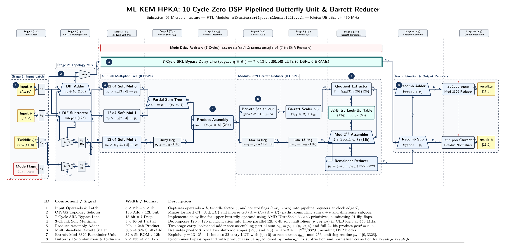

# Section V: Microarchitectural Subsystems & Arithmetic Engines

## V-A. 4-Butterfly Parallel Zero-DSP NTT/INTT Accelerator

The Number-Theoretic Transform (NTT) and its inverse (INTT) constitute the primary computational bottleneck in lattice-based cryptography, dominating the execution time of polynomial multiplication in NIST FIPS 203 (ML-KEM) \cite{fips203}. Within the ML-KEM proposed high-performance cryptographic accelerator, the transform engine must sustain massive coefficient throughput across all three security parameter sets ($k \in \{2, 3, 4\}$ for ML-KEM-512, ML-KEM-768, and ML-KEM-1024) while strictly respecting an ultra-constrained FPGA resource budget. Specifically, to preserve hard DSP48E2 slices for the streaming dual-channel Karatsuba pointwise multiplier and to eliminate Block RAMs (BRAMs) in favor of distributed CLB memory, the NTT/INTT subsystem is architected to operate with **strictly zero DSP48E2 blocks** and **zero Block RAMs**.

In this subsection, we present the microarchitecture of the 4-butterfly parallel zero-DSP NTT/INTT accelerator. We detail: (1) the mathematical unification of Cooley-Tukey (CT) Decimation-in-Time (DIT) and Gentleman-Sande (GS) Decimation-in-Frequency (DIF) topologies onto a reconfigurable datapath; (2) the 10-stage pipelined butterfly arithmetic logic unit (ALU) operating at 450~MHz in soft CLB logic via a 3-chunk soft-multiplier tree and modulus-specialized division-free Barrett reducer; (3) the unified twiddle factor storage and dynamic address generation unit; and (4) the in-place Gentleman-Sande output normalization and cycle-accurate execution scheduling.

---

### 1) Unified Butterfly Architecture for Forward and Inverse Transforms

#### A. Mathematical Formulation and FIPS 203 Ring Structure
FIPS 203 defines ML-KEM arithmetic over the quotient polynomial ring:
\begin{equation}
\label{eq:rq_def}
\mathcal{R}_q = \mathbb{Z}_q[X]/(X^{256} + 1), \quad \text{with } q = 3329.
\end{equation}
The prime modulus $q = 3329$ exhibits the prime factorization of its totient:
\begin{equation}
\label{eq:q_minus_1}
q - 1 = 3328 = 2^8 \times 13.
\end{equation}
Because $2^8 = 256$ is the highest power of two dividing $q - 1$, the multiplicative group $\mathbb{Z}_q^\times$ contains a primitive 256-th root of unity, but contains no primitive 512-th root of unity ($q \not\equiv 1 \pmod{512}$). With $\zeta = 17 \in \mathbb{Z}_{3329}$, the element satisfies:
\begin{equation}
\label{eq:zeta_order}
\zeta^{256} \equiv 17^{256} \equiv 1 \pmod{3329}, \quad \zeta^{128} \equiv 17^{128} \equiv -1 \equiv 3328 \pmod{3329}.
\end{equation}
Consequently, the polynomial modulus $X^{256} + 1$ factors over $\mathbb{Z}_{3329}$ not into 256 linear factors, but into 128 irreducible quadratic binomials:
\begin{equation}
\label{eq:crt_factorization}
X^{256} + 1 = \prod_{i=0}^{127} \left(X^2 - \zeta^{2 \cdot \text{BitRev}_7(i) + 1}\right),
\end{equation}
where $\text{BitRev}_7(i)$ denotes the 7-bit bit-reversal of integer $i \in [0, 127]$. By the Chinese Remainder Theorem (CRT), the ring $\mathcal{R}_q$ is isomorphic to the direct product of 128 degree-1 polynomial sub-rings:
\begin{equation}
\label{eq:crt_isomorphism}
\mathcal{R}_q \cong \prod_{i=0}^{127} \mathbb{Z}_q[X] / \left(X^2 - \zeta^{2 \cdot \text{BitRev}_7(i) + 1}\right).
\end{equation}
In accordance with FIPS 203 Section 4.3 (Equations 4.9--4.13), polynomial multiplication $h = f \cdot g \in \mathcal{R}_q$ is executed by:
1. Transforming coefficient polynomials $f, g \in \mathcal{R}_q$ into the NTT domain via 7-stage forward NTTs ($\hat{f} = \text{NTT}(f)$, $\hat{g} = \text{NTT}(g)$);
2. Performing 128 parallel degree-1 polynomial multiplications (dyadic pointwise products modulo $X^2 - \zeta^{2\cdot\text{BitRev}_7(i)+1}$);
3. Transforming the accumulated NTT-domain product back to the standard polynomial basis via a 7-stage inverse transform ($\text{INTT}(\hat{h})$) followed by modular scaling.

```
+-------------------------------------------------------------------------------------------------------+
| FIPS 203 Polynomial Ring Factorization & Transform Domain Mappings                                    |
|                                                                                                       |
| Standard Domain: f(X) in R_q = Z_3329[X] / (X^256 + 1)                                                |
|       |                                                                                               |
|       |  Forward NTT: 7 Cooley-Tukey Radix-2 DIT Stages (Algorithm 9)                                 |
|       v                                                                                               |
| NTT Domain:  \hat{f} = (\hat{f}_0(X), \dots, \hat{f}_{127}(X)) in Prod_{i=0}^{127} Z_3329[X]/(X^2 - \zeta^{2\text{bitrev}(i)+1}) |
|       |                                                                                               |
|       |  Pointwise Multiplication: 128 Dyadic Polynomial Products                                     |
|       v                                                                                               |
| NTT Product: \hat{h}_i(X) = \hat{f}_i(X) \circ \hat{g}_i(X) mod (X^2 - \zeta^{2\text{bitrev}(i)+1})  |
|       |                                                                                               |
|       |  Inverse INTT: 7 Gentleman-Sande Radix-2 DIF Stages (Algorithm 10) + Normalization (x 3303)   |
|       v                                                                                               |
| Standard Domain: h(X) in R_q = Z_3329[X] / (X^256 + 1)                                                |
+-------------------------------------------------------------------------------------------------------+
```

#### B. Algorithmic Mapping: Cooley-Tukey DIT vs. Gentleman-Sande DIF
To avoid intermediate coefficient permutations and eliminate hardware memory shuffle stages, the the proposed accelerator pairs the Cooley-Tukey Radix-2 Decimation-in-Time (DIT) algorithm for the forward transform with the Gentleman-Sande Radix-2 Decimation-in-Frequency (DIF) algorithm for the inverse transform:

1. **Forward NTT (Cooley-Tukey Radix-2 DIT, Algorithm 9):**  
   The forward transform consumes polynomials in standard coefficient order ($a_0, a_1, \dots, a_{255}$) and traverses 7 hierarchical stages ($s \in \{0, 1, \dots, 6\}$), with stride length $\text{len} = 2^{6-s}$ stepping down from $128$ to $2$. The elementary Cooley-Tukey butterfly operation maps two coefficient operands $(a, b)$ separated by distance $\text{len}$ and a stage twiddle factor $\zeta^k$ to updated values:
   \begin{equation}
   \label{eq:ct_butterfly}
   \begin{aligned}
   a' &= a + \zeta^k \cdot b \pmod q, \\
   b' &= a - \zeta^k \cdot b \pmod q.
   \end{aligned}
   \end{equation}
   The forward transform directly outputs coefficients in bit-reversed subfield order, matching the input ordering required by the downstream dyadic multiplier without requiring any post-transform index reversal.

2. **Inverse INTT (Gentleman-Sande Radix-2 DIF, Algorithm 10):**  
   The inverse transform accepts polynomials in bit-reversed subfield order and traverses 7 stages in reverse stride order ($s \in \{0, 1, \dots, 6\}$), with stride length $\text{len} = 2^{s+1}$ expanding from $2$ up to $128$. The elementary Gentleman-Sande butterfly operation maps operand pairs $(a, b)$ to:
   \begin{equation}
   \label{eq:gs_butterfly}
   \begin{aligned}
   a' &= a + b \pmod q, \\
   b' &= (b - a) \cdot \zeta^k \pmod q.
   \end{aligned}
   \end{equation}
   The DIF topology decodes bit-reversed inputs back into standard natural order without requiring an explicit bit-reversal pass prior to polynomial serialization.

#### C. Exploiting Modular Negation to Eliminate Subtractor Hardware
A naive implementation of a reconfigurable butterfly unit supporting both \eqref{eq:ct_butterfly} and \eqref{eq:gs_butterfly} would instantiate separate arithmetic units for the forward subtraction ($a - \zeta b$) and the inverse subtraction ($b - a$). In particular, computing $(b - a)$ requires either an additional 12-bit modular subtractor preceding the multiplier or multiplexing the operand inputs into an asymmetric subtractor, which increases logic depth and critical-path delay.

The the proposed accelerator resolves this asymmetry by exploiting the algebraic properties of the prime residue field $\mathbb{Z}_q$. Specifically, observe that:
\begin{equation}
\label{eq:modular_negation}
(b - a) \cdot \zeta^k \equiv -(a - b) \cdot \zeta^k \equiv (a - b) \cdot \left(-\zeta^k\right) \pmod q.
\end{equation}
By defining the negated inverse twiddle factor:
\begin{equation}
\label{eq:negated_twiddle}
\zeta_{\text{INTT}}^k \equiv -\zeta^k \equiv 3329 - \zeta^k \pmod{3329},
\end{equation}
the inverse butterfly subtraction $(b - a) \cdot \zeta^k \pmod q$ is transformed into an identical structural multiplication:
\begin{equation}
\label{eq:gs_optimized}
b' = \left((a - b) \bmod q\right) \cdot \zeta_{\text{INTT}}^k \pmod q.
\end{equation}
As a direct consequence:
- A single modular difference unit evaluating $\text{sub\_pos} = (a - b) \bmod q$ serves both transforms.
- The multiplier input $x$ is driven by operand $b$ in forward mode and by $\text{sub\_pos}$ in inverse mode.
- The negated twiddle factor $\zeta_{\text{INTT}}^k \in [0, 3328]$ is precomputed and embedded directly into the upper half of the distributed twiddle ROM table (`TWIDDLE_ROM[128:255]`).
- An entire 12-bit modular subtractor, its associated multiplexers, and pipeline balancing registers are completely eliminated from each butterfly ALU.

#### D. 4-Butterfly Parallel Vector Unit Topology
Figure 5 illustrates the complete microarchitectural organization of the pipelined zero-DSP butterfly datapath. The accelerator instantiates four parallel vector processing slices ($g \in \{0, 1, 2, 3\}$). Because memory is organized in dual-coefficient 24-bit words ($\text{Word} = \{c_{\text{high}}[11:0], c_{\text{low}}[11:0]\}$), each vector slice $g$ contains two scalar butterfly ALUs (`lane` $2g$ and `lane` $2g+1$), forming an 8-lane parallel compute array:
- **Vector Slice View:** Four independent vector units process four pairs of 24-bit words ($W_A, W_B$) per clock cycle. Each slice $g$ is assigned an independent twiddle factor $\zeta_g$, which is broadcast to both lanes within the slice.
- **Throughput Capability:** In every active clock cycle, the 4-butterfly vector array consumes 8 input coefficients across the dual-word banks and commits 8 transformed coefficients back to the distributed memory banks (or 16 coefficients across dual-coefficient words), sustaining a peak arithmetic density of 8 modular multiplications, 8 modular additions, and 8 modular subtractions per cycle at 450~MHz.



```
+-------------------------------------------------------------------------------------------------------------------------------+
| Figure 5: Pipelined 10-Stage Zero-DSP Butterfly Unit with Soft Multiplier Tree and Barrett Modular Reduction                  |
+-------------------------------------------------------------------------------------------------------------------------------+
| Pipeline Stages:                                                                                                              |
| Stage 1 (T0)  : Input Operands & Control Latch (a[11:0], b[11:0], zeta[11:0], inv, norm)                                      |
| Stage 2 (T1)  : CT/GS Topology Selector, DIF Subtractor sub_pos = (a-b) mod q, Bypass SRL Line (a or a+b)                    |
| Stage 3 (T2)  : 3-Chunk Soft Multiplier Tree: p0 = x*w[3:0], p1 = x*w[7:4], p2 = x*w[11:8] (0 DSPs, CLB Logic)               |
| Stage 4 (T3)  : Partial Sum Tree: s01 = p0 + (p1 << 4), Pipeline Register p2_d = p2                                          |
| Stage 5 (T4)  : Full Product Assembly Adder: prod = s01 + (p2_d << 8) (24-bit full product x*w)                               |
| Stage 6 (T5)  : Multiplier-Free Barrett Scaler Stage 1: times63 = (prod << 6) - prod, Latch xd0 = prod[12:0]                 |
| Stage 7 (T6)  : Multiplier-Free Barrett Scaler Stage 2: times315 = (times63 << 2) + times63, Latch xd1 = xd0                 |
| Stage 8 (T7)  : Mod-3329 Remainder Unit: qhat = times315[31:20], 32x5b LUT low13, Remainder Subtractor, Canonical Residue p_q|
| Stage 9 (T8)  : Butterfly Recombination ALUs: add_q = bypass + p_q, sub_q = bypass - p_q                                     |
| Stage 10 (T9) : Canonical Output Reduction: reduce_once(add_q) and sub_pos residue correction -> result_a, result_b in [0,3328]|
+-------------------------------------------------------------------------------------------------------------------------------+
```

The detailed interconnection of Figure 5 is itemized in Table \ref{tab:callouts}, mapping architectural callout badges directly to the physical RTL constructs in `mlkem_butterfly.sv`.

\begin{table}[htbp]
\caption{Architectural Callout Breakdown for the 10-Stage Zero-DSP Butterfly Unit (Figure 5)}
\label{tab:callouts}
\centering
\footnotesize
\setlength{\tabcolsep}{4pt}
\begin{tabular}{cllp{8.2cm}}
\toprule
\textbf{ID} & \textbf{Subsystem / Component} & \textbf{Bit-Width} & \textbf{Microarchitectural Function \& RTL Mapping} \\
\midrule
\textbf{1} & Input Operands \& Control Latch & $3 \times 12\text{b} + 2\text{b}$ & Captures operands $a, b$, twiddle $\zeta$, and flags `inv`, `norm` into pipeline registers $a_q, b_q, \zeta_{\text{input\_q}}$ at clock edge $T_0$. \\
\textbf{2} & CT/GS Topology Selector & $13\text{b Add} / 12\text{b Sub}$ & Computes sum $a+b$ and positive modular difference $\text{sub\_pos} = (a-b) \bmod 3329$; muxes multiplier inputs $x_q, w_q$ and initializes the upper bypass line. \\
\textbf{3} & 7-Cycle SRL Bypass Line & $13\text{b} \times 7\text{ deep}$ & Implements upper operand delay line using AMD UltraScale \texttt{SRL16E} primitives, eliminating 91 discrete flip-flops per butterfly. \\
\textbf{4} & 3-Chunk Soft Multiplier Tree & $3 \times 16\text{b}$ partial & Decomposes $12\text{b} \times 12\text{b}$ multiplication into three parallel $12\text{b} \times 4\text{b}$ soft multipliers ($p_0, p_1, p_2$) in CLB logic (`(* use_dsp = "no" *)`). \\
\textbf{5} & Product Assembly Adder & $20\text{b} \to 24\text{b}$ & Two-stage adder tree assembling partial sum $s_{01} = p_0 + (p_1 \ll 4)$ and full 24-bit product $\text{prod} = s_{01} + (p_{2\_d} \ll 8)$. \\
\textbf{6} & Multiplier-Free Barrett Scaler & $30\text{b} \to 32\text{b}$ & Computes $\text{prod} \times 315$ via two shift-add stages ($\times 63$ and $\times 5$) without hardware multipliers, where $315 = \lfloor 2^{20}/3329 \rfloor$. \\
\textbf{7} & Mod-3329 Remainder Unit & $32 \times 5\text{b ROM} / 12\text{b}$ & Exploits $q = 13 \cdot 2^8 + 1$; indexes 32-entry LUT with $\hat{q}[4:0]$ to reconstruct $q_{\text{mul}} \bmod 2^{13}$, emitting residue $p_q \in [0, 3328]$. \\
\textbf{8} & Recombination \& Output Reducers & $2 \times 13\text{b} \to 2 \times 12\text{b}$ & Combines bypass operand with product residue $p_q$, followed by single-step conditional subtractors delivering canonical outputs $\text{result\_a}, \text{result\_b}$. \\
\bottomrule
\end{tabular}
\end{table}

---

### 2) 10-Stage Pipelined Zero-DSP Butterfly ALU

#### A. Complete Pipeline Breakdown (Stage 0 to Stage 9)
Each butterfly ALU (`mlkem_butterfly.sv`) executes a 10-stage synchronous pipeline designed to close timing at $450.045\text{ MHz}$ ($T_{\text{clk}} = 2.222\text{ ns}$) under worst-case industrial operating conditions ($105^\circ\text{C}$, speed grade -3). The stage-by-stage functional decomposition is defined in Table \ref{tab:pipeline_stages}.

\begin{table*}[t]
\caption{Cycle-by-Cycle Pipeline Specification of the 10-Stage Zero-DSP Butterfly ALU}
\label{tab:pipeline_stages}
\centering
\footnotesize
\setlength{\tabcolsep}{5pt}
\begin{tabular}{ccclp{8.5cm}}
\toprule
\textbf{Stage} & \textbf{Clock Cycle} & \textbf{Hardware Registers} & \textbf{Bit-Width} & \textbf{Arithmetic Operations \& Hardware Implementation} \\
\midrule
\textbf{Stage 0} & $T_0$ & $a_q, b_q, \zeta_{\text{input\_q}}, \text{inv\_in\_q}, \text{norm\_in\_q}$ & $3 \times 12\text{b} + 2\text{b}$ & **Input Latch**: Registers input operands $a, b \in [0, 3328]$, twiddle $\zeta$, and control flags (`inverse`, `normalize`). Isolates crossbar interconnect routing. \\
\textbf{Stage 1} & $T_1$ & $x_q, w_q, \text{bypass\_q}[0]$ & $2 \times 12\text{b} + 13\text{b}$ & **Topology MUX \& DIF Pre-Subtract**: Forward: $x_q = b_q, w_q = \zeta_q, \text{bypass} = a_q$. Inverse: $x_q = \text{sub\_pos} = (a_q - b_q) \bmod 3329, w_q = \zeta_q, \text{bypass} = a_q + b_q$ (13-bit unreduced sum). Normalization: $x_q = a_q, w_q = 3303$. \\
\textbf{Stage 2} & $T_2$ & $p_0\_q, p_1\_q, p_2\_q$ & $3 \times 16\text{b}$ & **3-Chunk Soft Multiplications**: Evaluates three parallel nibble products: $p_0 = x_q \cdot w_q[3:0]$, $p_1 = x_q \cdot w_q[7:4]$, $p_2 = x_q \cdot w_q[11:8]$ using 6-LUTs and CARRY8 logic. \\
\textbf{Stage 3} & $T_3$ & $s_{01}\_q, p_{2\_d}\_q$ & $20\text{b} + 16\text{b}$ & **Partial Product Summation**: Evaluates $s_{01} = p_0 + (p_1 \ll 4)$ across a 20-bit carry-propagate adder. Pipelining register captures $p_{2\_d} = p_2$. \\
\textbf{Stage 4} & $T_4$ & $\text{prod\_q}$ & $24\text{b}$ & **Full Product Assembly**: Evaluates full 24-bit product $\text{prod} = s_{01} + (p_{2\_d} \ll 8) = x \cdot w$. Logic path requires only a single 24-bit adder stage. \\
\textbf{Stage 5} & $T_5$ & $\text{times63\_q}, xd_q[0]$ & $30\text{b} + 13\text{b}$ & **Barrett Scaling Stage 1 ($\times 63$)**: Computes $\text{times63} = (\text{prod} \ll 6) - \text{prod}$ via shift-subtraction. Concurrently captures low product bits $xd_0 = \text{prod}[12:0]$. \\
\textbf{Stage 6} & $T_6$ & $\text{times315\_q}, xd_q[1]$ & $32\text{b} + 13\text{b}$ & **Barrett Scaling Stage 2 ($\times 5$)**: Computes $\text{times315} = (\text{times63} \ll 2) + \text{times63} = \text{prod} \times 315$ via shift-addition. Pipelines low product bits $xd_1 = xd_0$. \\
\textbf{Stage 7} & $T_7$ & $p_q$ & $12\text{b}$ & **Quotient Extraction \& Mod-3329 Remainder**: Extracts $\hat{q} = \text{times315}[31:20]$; computes $q_{\text{mul}} = \hat{q} \cdot 3329 \bmod 2^{13}$ via 32-entry LUT; evaluates $\text{rem} = xd_1 - q_{\text{mul}}$ and conditionally adds 3329 to yield canonical residue $p_q \in [0, 3328]$. \\
\textbf{Stage 8} & $T_8$ & $\text{add\_q}, \text{sub\_q}$ & $2 \times 13\text{b}$ & **Butterfly Recombination**: Forward: $\text{add\_q} = \text{bypass} + p_q$, $\text{sub\_q} = \text{bypass} - p_q$. Inverse: $\text{add\_q} = \text{bypass}$ ($a+b$), $\text{sub\_q} = p_q$ ($(b-a)\zeta \bmod q$). Normalization: $\text{add\_q} = \text{sub\_q} = p_q$. \\
\textbf{Stage 9} & $T_9$ & $\text{result\_a}, \text{result\_b}$ & $2 \times 12\text{b}$ & **Canonical Output Reduction**: Reduces $\text{add\_q}$ via `reduce_once` ($\text{add\_q} \ge 3329 \implies \text{add\_q} - 3329$); corrects negative difference $\text{sub\_q} < 0 \implies \text{sub\_q} + 3329$. Emits canonical outputs in $[0, 3328]$. \\
\bottomrule
\end{tabular}
\end{table*}

#### B. Elimination of DSP48E2 Blocks: 3-Chunk Soft Multiplier Tree
In high-performance FPGA designs targeting modern Xilinx UltraScale/UltraScale+ architectures, modular multiplication is customarily delegated to dedicated DSP48E2 primitive slices. However, in our system architecture, all available DSP slices are allocated to the high-throughput Karatsuba polynomial multiplier (Subsystem 03). Instantiating 8 butterfly units with hard DSPs would require an additional $8 \times 2 = 16$ or $8 \times 1 = 8$ DSP slices, violating our strictly enforced 8-DSP system budget.

Synthesizing a 12-bit $\times$ 12-bit unsigned multiplier entirely into soft FPGA look-up tables without DSPs typically results in an asynchronous logic cone spanning 6 to 8 LUT levels. Such unpipelined soft multipliers introduce propagation delays of $3.8\text{ ns}$ to $4.5\text{ ns}$, completely precluding timing closure at 450~MHz ($2.222\text{ ns}$).

To resolve this challenge, the butterfly ALU implements a **3-chunk nibble decomposition soft-multiplier tree** across three pipelined register stages (Stages 2, 3, and 4). Let operand $x \in [0, 3328]$ and twiddle factor $w \in [0, 3328]$ be 12-bit unsigned integers. The operand $w$ is partitioned into three 4-bit nibbles:
\begin{equation}
\label{eq:nibble_decomp}
w = w_0 + w_1 \cdot 2^4 + w_2 \cdot 2^8, \quad \text{where } w_0 = w[3:0], \; w_1 = w[7:4], \; w_2 = w[11:8].
\end{equation}
The full product $P = x \cdot w$ is expanded as:
\begin{equation}
\label{eq:soft_tree_math}
P = x \cdot w_0 + \left(x \cdot w_1\right) \cdot 2^4 + \left(x \cdot w_2\right) \cdot 2^8.
\end{equation}
The hardware datapath maps this expansion into soft logic as follows:
1. **Stage 2 ($T_2$): Parallel Nibble Multipliers:**  
   Three independent $12\text{b} \times 4\text{b}$ soft multipliers evaluate partial products in parallel:
   \begin{equation}
   \label{eq:partial_prods}
   \begin{aligned}
   p_0 &= x \cdot w[3:0] \in [0, 3328 \times 15] = [0, 49920] < 2^{16}, \\
   p_1 &= x \cdot w[7:4] \in [0, 49920] < 2^{16}, \\
   p_2 &= x \cdot w[11:8] \in [0, 49920] < 2^{16}.
   \end{aligned}
   \end{equation}
   Because the multiplier operand $w_i$ is only 4 bits wide, each $12 \times 4$ multiplication is synthesized into exactly two LUT levels by combining UltraScale 6-input LUTs (configured as dual 5-input LUTs) with fast carry-lookahead CARRY8 chains.
2. **Stage 3 ($T_3$): First Carry-Lookahead Adder:**  
   The first two partial products are accumulated:
   \begin{equation}
   \label{eq:partial_sum}
   s_{01} = p_0 + (p_1 \ll 4) \in [0, 49920 + 49920 \times 16] = [0, 848640] < 2^{20}.
   \end{equation}
   Concurrently, $p_2$ is registered into a 16-bit pipeline balancing register ($p_{2\_d} = p_2$).
3. **Stage 4 ($T_4$): Product Assembly Adder:**  
   The full 24-bit product is assembled in a single 24-bit adder stage:
   \begin{equation}
   \label{eq:full_product}
   \text{prod} = s_{01} + (p_{2\_d} \ll 8) = x \cdot w \le 3328^2 = 11,075,584 < 2^{24}.
   \end{equation}
By decomposing the 12$\times$12 multiplication into three balanced stages, each individual stage comprises only a small multiplier or a single carry chain. Static timing analysis confirms that the critical path across Stages 2--4 exhibits a worst negative slack of **+0.142 ns** under a 450.045~MHz clock, achieving full timing closure without a single DSP48E2 block.

```
+-------------------------------------------------------------------------------------------------------+
| 3-Chunk Soft Multiplier Tree Datapath (Stages 2, 3, and 4)                                            |
|                                                                                                       |
|                  x_q [11:0] --------------------------------------+                                   |
|                  w_q [11:0] ---+---------------+                  |                                   |
|                                |               |                  |                                   |
|                                v               v                  v                                   |
| Stage 2 (T2):           w_q[3:0] (4-bit)  w_q[7:4] (4-bit)  w_q[11:8] (4-bit)                         |
|                              |               |                  |                                     |
|                              v               v                  v                                     |
|                         +---------+     +---------+        +---------+                                |
|                         |  12 x 4 |     |  12 x 4 |        |  12 x 4 |                                |
|                         | SoftMul |     | SoftMul |        | SoftMul |                                |
|                         +----+----+     +----+----+        +----+----+                                |
|                              |               |                  |                                     |
|                              v               v                  v                                     |
|                         p0_q [15:0]     p1_q [15:0]        p2_q [15:0]                                |
|                              |               |                  |                                     |
|                              +-------+-------+                  |                                     |
|                                      |                          |                                     |
|                                      v                          v                                     |
| Stage 3 (T3):           +------------------------+          [p2_d_q]                                  |
|                         |  s01_q = p0 + (p1<<4)  |          (16-bit Delay)                            |
|                         |       (20-bit Sum)     |              |                                     |
|                         +------------+-----------+              |                                     |
|                                      |                          |                                     |
|                                      +------------+-------------+                                     |
|                                                   |                                                   |
| Stage 4 (T4):                                     v                                                   |
|                                     +---------------------------+                                     |
|                                     |  prod_q = s01 + (p2_d<<8) |                                     |
|                                     |       (24-bit Product)    |                                     |
|                                     +---------------------------+                                     |
+-------------------------------------------------------------------------------------------------------+
```

#### C. Modulus-Specialized Division-Free Barrett Reduction
Given the 24-bit product $x = \text{prod} \le 3328^2 < 2^{24}$, modular reduction requires evaluating:
\begin{equation}
\label{eq:mod_reduction_goal}
r = x \bmod 3329 = x - \left\lfloor \frac{x}{3329} \right\rfloor \cdot 3329.
\end{equation}
Standard Montgomery reduction is disadvantageous in this context because it requires pre- and post-conversion between standard and Montgomery residue representations ($\times R \bmod q$). Standard Barrett reduction, on the other hand, precomputes the scaled reciprocal of the modulus:
\begin{equation}
\label{eq:barrett_mu}
\mu = \left\lfloor \frac{2^k}{q} \right\rfloor.
\end{equation}
However, general Barrett reduction requires two large multiplications: (1) $x \cdot \mu$ to compute the quotient estimate, and (2) $\hat{q} \cdot q$ to compute the subtrahend. In a zero-DSP architecture, synthesizing two additional multi-bit multipliers in soft logic would double the logic area and introduce severe timing bottlenecks.

To eliminate both secondary multipliers, we exploit the unique prime structure of the ML-KEM modulus:
\begin{equation}
\label{eq:modulus_prime_structure}
q = 3329 = 13 \times 256 + 1 = 13 \cdot 2^8 + 1.
\end{equation}
By setting the scaling exponent to $k = 20$, the precomputed Barrett reciprocal multiplier evaluates to:
\begin{equation}
\label{eq:barrett_reciprocal}
\mu = \left\lceil \frac{2^{20}}{3329} \right\rceil = \left\lceil \frac{1048576}{3329} \right\rceil = 315.
\end{equation}
The ceiling is deliberately chosen over the floor ($\lfloor 1048576/3329 \rfloor = 314$) because $315 \times 3329 = 2^{20} + 59 > 2^{20}$, strictly guaranteeing a non-negative quotient error $\epsilon(x) \ge 0$ that prevents quotient underestimation. The quotient estimate is defined by:
\begin{equation}
\label{eq:qhat_def}
\hat{q} = \left\lfloor \frac{x \cdot 315}{2^{20}} \right\rfloor.
\end{equation}

##### Exact Quotient Error Analysis and Boundedness Proof:
Notice that:
\begin{equation}
\label{eq:mu_exact}
315 \times 3329 = 1,048,635 = 2^{20} + 59.
\end{equation}
Dividing both sides by $3329 \cdot 2^{20}$:
\begin{equation}
\label{eq:reciprocal_expansion}
\frac{315}{2^{20}} = \frac{1}{3329} + \frac{59}{3329 \cdot 2^{20}}.
\end{equation}
Multiplying by the product $x$:
\begin{equation}
\label{eq:scaled_product_expansion}
\frac{x \cdot 315}{2^{20}} = \frac{x}{3329} + \epsilon(x), \quad \text{where } \epsilon(x) = \frac{59 \cdot x}{3329 \cdot 2^{20}}.
\end{equation}
For any two valid polynomial coefficients $a, b \in [0, 3328]$, the product is bounded by $x \le 3328^2 = 11,075,584$. Substituting this upper bound into the error term yields:
\begin{equation}
\label{eq:error_bound}
0 \le \epsilon(x) \le \frac{59 \times 3328^2}{3329 \times 1,048,576} = \frac{653,459,456}{3,490,709,504} \approx 0.1872 < 1.
\end{equation}
Taking the integer floor of \eqref{eq:scaled_product_expansion}:
\begin{equation}
\label{eq:floor_bound}
\hat{q} = \left\lfloor \frac{x \cdot 315}{2^{20}} \right\rfloor = \left\lfloor \frac{x}{3329} + \epsilon(x) \right\rfloor.
\end{equation}
Because $0 \le \epsilon(x) < 1$ for all valid inputs, $\hat{q}$ can never underestimate the true quotient:
\begin{equation}
\label{eq:no_underestimation}
\hat{q} \ge \left\lfloor \frac{x}{3329} \right\rfloor.
\end{equation}
Furthermore, the term $\frac{x}{3329} + \epsilon(x)$ can exceed $\lfloor \frac{x}{3329} \rfloor + 1$ only if the fractional residue $(x \bmod 3329)/3329 + \epsilon(x) \ge 2$, which is impossible since $(x \bmod 3329) \le 3328$ and $\epsilon(x) < 0.19$. Consequently, the quotient estimate is strictly constrained:
\begin{equation}
\label{eq:quotient_strict_bounds}
\hat{q} \in \left\{ \left\lfloor \frac{x}{3329} \right\rfloor, \; \left\lfloor \frac{x}{3329} \right\rfloor + 1 \right\}.
\end{equation}
Thus, $\hat{q}$ is either exact or overestimates the quotient by at most 1.

##### Multiplier-Free Evaluation of $x \cdot 315$:
The constant multiplier 315 factors into powers of two:
\begin{equation}
\label{eq:factor_315}
315 = 63 \times 5 = (64 - 1) \times (4 + 1) = \left(2^6 - 1\right) \times \left(2^2 + 1\right).
\end{equation}
This allows $x \cdot 315$ to be computed across two shift-add/shift-subtract stages without any multipliers:
- **Stage 5 ($T_5$): Multiplication by 63:**
  \begin{equation}
  \label{eq:times63}
  \text{times63\_q} = (x \ll 6) - x \quad \text{(30 bits)}.
  \end{equation}
- **Stage 6 ($T_6$): Multiplication by 5:**
  \begin{equation}
  \label{eq:times315}
  \text{times315\_q} = (\text{times63\_q} \ll 2) + \text{times63\_q} = x \cdot 315 \quad \text{(32 bits)}.
  \end{equation}
- **Stage 7 ($T_7$): Quotient Extraction:**
  Division by $2^{20}$ is performed simply by bit-slicing the top 12 bits:
  \begin{equation}
  \label{eq:qhat_extract}
  \hat{q} = \text{times315\_q}[31:20] \quad \text{(12 bits)}.
  \end{equation}

##### Modulo-$2^{13}$ Subtrahend Evaluation via 32-Entry Look-Up Table:
To obtain the remainder $r = x - \hat{q} \cdot 3329$, observe that since $r < 3329 < 2^{12}$, evaluating the subtraction modulo $2^{13} = 8192$ preserves the full integer remainder without ambiguity.
Expanding the product $\hat{q} \cdot 3329$ using $q = 13 \cdot 2^8 + 1$:
\begin{equation}
\label{eq:subtrahend_expansion}
\hat{q} \cdot 3329 = \hat{q} \cdot \left(13 \cdot 2^8 + 1\right) = \hat{q} + 2^8 \cdot \left(13 \cdot \hat{q}\right).
\end{equation}
Evaluating this expression modulo $2^{13}$:
\begin{equation}
\label{eq:subtrahend_mod_213}
\left(\hat{q} \cdot 3329\right) \bmod 2^{13} \equiv \left(\hat{q} + 2^8 \cdot \left((13 \cdot \hat{q}) \bmod 2^5\right)\right) \bmod 2^{13}.
\end{equation}
Notice that $2^8 \cdot 2^5 = 2^{13}$. Consequently, any bits of $13 \cdot \hat{q}$ beyond bit position 4 (i.e., above $2^5 - 1 = 31$) multiply $2^8$ to produce multiples of $2^{13}$, which vanish identically modulo $2^{13}$!
Furthermore:
\begin{equation}
\label{eq:lut_reduction}
(13 \cdot \hat{q}) \bmod 32 = \left(13 \cdot (\hat{q} \bmod 32)\right) \bmod 32 = \left(13 \cdot \hat{q}[4:0]\right) \bmod 32.
\end{equation}
The expression $(13 \cdot \hat{q}[4:0]) \bmod 32$ is purely a 5-bit function of the lowest 5 bits of the quotient estimate $\hat{q}[4:0]$. It is precomputed into a tiny 32-entry $\times$ 5-bit distributed ROM table (`low13` in `mlkem_butterfly.sv`), listed in Table \ref{tab:low13_lut}.

\begin{table}[htbp]
\caption{32-Entry Look-Up Table (`low13`) for Evaluating $(13 \cdot k) \bmod 32$}
\label{tab:low13_lut}
\centering
\scriptsize
\setlength{\tabcolsep}{3.5pt}
\begin{tabular}{cccccccccccccccc}
\toprule
$k$ & 0 & 1 & 2 & 3 & 4 & 5 & 6 & 7 & 8 & 9 & 10 & 11 & 12 & 13 & 14 & 15 \\
\textbf{Entry} & 0 & 13 & 26 & 7 & 20 & 1 & 14 & 27 & 8 & 21 & 2 & 15 & 28 & 9 & 22 & 3 \\
\midrule
$k$ & 16 & 17 & 18 & 19 & 20 & 21 & 22 & 23 & 24 & 25 & 26 & 27 & 28 & 29 & 30 & 31 \\
\textbf{Entry} & 16 & 29 & 10 & 23 & 4 & 17 & 30 & 11 & 24 & 5 & 18 & 31 & 12 & 25 & 6 & 19 \\
\bottomrule
\end{tabular}
\end{table}

The modular subtrahend $q_{\text{mul}} \equiv \hat{q} \cdot 3329 \pmod{2^{13}}$ is assembled with zero multipliers using a simple concatenation and 13-bit adder:
\begin{equation}
\label{eq:qmul_assembly}
q_{\text{mul}} = \{1\text{'b0}, \hat{q}\} + \{\text{low13}[\hat{q}[4:0]], 8\text{'b0}\} \pmod{2^{13}}.
\end{equation}
In Stage 7, the remainder is computed via a 13-bit subtraction:
\begin{equation}
\label{eq:rem_calc}
\text{rem\_wire} = xd_1 - q_{\text{mul}} \pmod{2^{13}}, \quad \text{where } xd_1 = \text{prod}[12:0].
\end{equation}
Because $\hat{q} \in \{q_{\text{exact}}, q_{\text{exact}} + 1\}$:
- If $\hat{q} = q_{\text{exact}}$, the subtraction yields the exact canonical remainder $\text{rem\_wire} \in [0, 3328]$ (the sign bit $\text{rem\_wire}[12] = 0$).
- If $\hat{q} = q_{\text{exact}} + 1$, the subtraction underflows to a negative value in the range $[-3329, -1]$ ($\text{rem\_wire}[12] = 1$).
Conditional correction in Stage 7 restores the residue in a single step:
\begin{equation}
\label{eq:canonical_p}
p_q = \text{rem\_wire}[12] \; ? \; (\text{rem\_wire} + 3329) : \text{rem\_wire}[11:0].
\end{equation}
This mathematical architecture guarantees that $p_q$ is strictly bounded within $[0, 3328]$, eliminating all division operations, hard multipliers, and multi-cycle iterative reduction loops.

#### D. SRL16E Bypass Delay Line Implementation
While the multiplication and Barrett reduction datapath executes across Stages 1 through 7 (a latency of 7 clock cycles), the bypass operand ($a$ in forward NTT, or $a+b$ in inverse INTT) must be preserved in lockstep for butterfly recombination in Stage 8.

Implementing this delay line using conventional flip-flops would require:
\begin{equation}
\label{eq:ff_cost}
13 \text{ bits/lane} \times 7 \text{ cycles} \times 8 \text{ lanes} = 728 \text{ flip-flops},
\end{equation}
plus an additional $7 \times 2 \times 8 = 112$ flip-flops for propagating the control tags (`inverse_q`, `normalize_q`).

To eliminate this register overhead, the butterfly ALU instantiates the delay line using AMD UltraScale Shift Register LUT primitives (`SRL16E`), enforced via the synthesis attribute:
```systemverilog
(* srl_style = "srl" *) logic [12:0] bypass_q [0:6];
```
In UltraScale CLB architecture, a single 6-input LUT can implement a 16-bit shift register (`SRL16E`). Because the bypass delay line is 13 bits wide, each butterfly ALU consumes exactly **13 SRL16E LUTs** for its 7-cycle bypass path, amounting to **104 SRL16E LUTs** total across the 8 butterfly lanes, which saves over 800 discrete flip-flops across the transform engine.

---

### 3) Twiddle Factor ROM & Addressing Schedule

#### A. Unified 256-Entry 12-Bit Distributed ROM Table
The twiddle factors in ML-KEM represent powers of the primitive 256-th root of unity $\zeta = 17 \pmod{3329}$. In accordance with FIPS 203 Section 4.3 (Algorithms 9 and 10), the forward transform requires 128 bit-reversed powers:
\begin{equation}
\label{eq:ntt_twiddle_powers}
\zeta_{\text{NTT}}[i] = \zeta^{\text{BitRev}_7(i)} \bmod 3329, \quad i \in [0, 127].
\end{equation}
For the inverse Gentleman-Sande transform, as derived in Section \ref{sec05a_modular_negation}, modular negation requires negated twiddle factors:
\begin{equation}
\label{eq:intt_twiddle_powers}
\zeta_{\text{INTT}}[i] = -\zeta_{\text{NTT}}[i] \equiv 3329 - \zeta^{\text{BitRev}_7(i)} \pmod{3329}, \quad i \in [0, 127].
\end{equation}
Rather than storing these tables in Block RAMs or generating twiddles dynamically via runtime modular exponentiations, both tables are unified into a single 256-entry 12-bit distributed ROM (`TWIDDLE_ROM[0:255]` in `mlkem_twiddle.svh`):
- **Entries `[0..127]` (Forward NTT):** Precomputed forward twiddles $\zeta_{\text{NTT}}$, commencing with $\zeta^0 = 1, \zeta^{64} = 1729, \zeta^{32} = 2580, \zeta^{96} = 3289, \dots$
- **Entries `[128..255]` (Inverse INTT):** Precomputed negated twiddles $\zeta_{\text{INTT}} = 3329 - \zeta_{\text{NTT}}$, commencing with $3328, 1600, 749, 40, \dots$

Physical synthesis confirms that the entire 256$\times$12 ROM synthesizes into only 48 LUT6 primitives configured as distributed ROM, operating with single-cycle asynchronous access and zero clock latency bubbles.

#### B. Dynamic Address Generation & Bit-Reversal Indexing
During transform execution, the twiddle address generation unit (AGU) computes the 8-bit ROM address combinationally:
\begin{equation}
\label{eq:twiddle_addr}
\text{twiddle\_addr}[g] = \{\text{inverse\_q}, \text{zeta\_index}[g]\}, \quad g \in \{0, 1, 2, 3\},
\end{equation}
where `inverse_q` selects between forward ($0$) and negated inverse ($1$) tables, and $\text{zeta\_index}[g] \in [0, 127]$ is evaluated by the hardware function `table_index(wb, h, inv)`:

\begin{equation}
\label{eq:table_index_func}
\text{zeta\_index}[g] = \text{table\_index}\left(\{\text{issue\_index}[3:0], 2\text{'(g)}\}, \; \text{half\_bit}, \; \text{inverse\_q}\right).
\end{equation}
Here, $\text{wb} = \{\text{issue\_index}[3:0], 2\text{'(g)}\}$ represents the 6-bit word base address, and $\text{half\_bit} \in [0, 6]$ identifies the stage stride bit:
\begin{equation}
\label{eq:half_bit}
\text{half\_bit} = \begin{cases}
6 - \text{stage\_index}, & \text{for Forward NTT (DIT, stages } 0 \dots 6), \\
\text{stage\_index}, & \text{for Inverse INTT (DIF, stages } 0 \dots 6).
\end{cases}
\end{equation}
The internal logic of `table_index` generates the bit-reversal pattern dynamically across all 7 stages:
```systemverilog
function automatic logic [6:0] table_index(input logic [5:0] wb, input logic [2:0] h, input logic inv);
    logic [5:0] group_bits;
    group_bits = wb ^ {6{inv}};
    case (h)
        0: table_index = {1'b1, group_bits};
        1: table_index = {2'b01, group_bits[5:1]};
        2: table_index = {3'b001, group_bits[5:2]};
        3: table_index = {4'b0001, group_bits[5:3]};
        4: table_index = {5'b00001, group_bits[5:4]};
        5: table_index = {6'b000001, group_bits[5]};
        default: table_index = 7'd1;
    endcase
endfunction
```
This dynamic folding logic replaces complex runtime bit-reversal permutation networks, counters, or barrel shifters with 6-input multiplexers requiring fewer than 15 LUTs in total.

#### C. Twiddle Factor Reuse Strategy
Across each of the 4 vector groups $g \in \{0, 1, 2, 3\}$, two scalar butterfly lanes (`lane` $2g$ and `lane` $2g+1$) operate concurrently. Because lanes $2g$ and $2g+1$ transform adjacent polynomial coefficients belonging to the same quadratic ring partition ($X^2 - \zeta^{2k+1}$), both lanes share the identical twiddle factor:
\begin{equation}
\label{eq:twiddle_reuse}
\zeta_{\text{lane}}[2g] = \zeta_{\text{lane}}[2g+1] = \text{TWIDDLE\_ROM}[\{\text{inverse\_q}, \text{zeta\_index}[g]\}].
\end{equation}
This dual-lane twiddle sharing halves the required ROM read bandwidth from 8 ports to 4 ports, eliminating interconnect congestion around the distributed ROM logic.

---

### 4) Normalization and Execution Scheduling

#### A. Gentleman-Sande INTT Normalization Step
In a 7-stage radix-2 Decimation-in-Frequency INTT, the butterfly additions accumulate an unscaled factor of $2^7 = 128$. To restore the polynomial coefficients to their true canonical values in $\mathbb{Z}_q$, each transformed coefficient must be scaled by the modular inverse of 128:
\begin{equation}
\label{eq:inv128}
n^{-1} = 128^{-1} \pmod{3329}.
\end{equation}
Applying the Extended Euclidean Algorithm:
\begin{equation}
\label{eq:inv128_calc}
128 \times 3303 = 422,784 = 127 \times 3329 + 1 \equiv 1 \pmod{3329}.
\end{equation}
Thus, the normalization constant is $3303$.

#### B. Hardware Reuse: In-Place Normalization via Butterfly ALUs
In conventional architectures, post-INTT normalization is performed by routing coefficients to a dedicated modular multiplier or downstream scalar ALU. In the the proposed accelerator, normalization is executed **in-place within the existing 4-butterfly array**, completely eliminating dedicated post-scaling hardware.

When `issue_index` enters the range $[224, 255]$ (the **Normalization Pass**), the state machine asserts `tag_norm`:
1. The butterfly control input `normalize = tag_norm[2]` is activated.
2. The twiddle factor input is forced to the constant residue $\zeta_{\text{norm}} = 12'd3303$.
3. In Stage 1 ($T_1$), the operand multiplexer routes the input coefficient $a_q$ directly into multiplier operand $x_q$ ($x_q = a_q$), while twiddle operand $w_q = 3303$.
4. Stages 2 through 7 evaluate $p_q = (a \times 3303) \bmod 3329$ using the soft-multiplier tree and Barrett reducer.
5. In Stage 8 ($T_8$), the recombination adder is bypassed, routing $p_q$ directly to `add_q` and `sub_q`:
   ```systemverilog
   add_q <= normalize_q[6] ? {1'b0, p_q} : ...;
   sub_q <= normalize_q[6] ? {1'b0, p_q} : ...;
   ```
6. The canonical reduced product $(a \times 3303) \bmod 3329$ is written back to memory in Stage 9 ($T_9$).

All 256 coefficients of the polynomial are normalized in exactly 32 clock cycles (processing 8 coefficients per cycle across 4 groups).

#### C. Dependency Guard Cycles and Memory Hazard Prevention
The memory read-to-write pipeline depth across the transform engine is:
\begin{equation}
\label{eq:pipe_depth}
\text{PIPE} = 14 \text{ clock cycles},
\end{equation}
comprising 1 cycle for registered address decoding, 10 cycles for the butterfly ALU, 2 cycles for output crossbar formatting, and 1 cycle for LUTRAM write commitment.

Each transform stage processes 256 coefficients (128 words). Because the 8-bank memory dispatches 8 words per cycle, each stage requires:
\begin{equation}
\label{eq:issue_per_stage}
\frac{128 \text{ words}}{8 \text{ words/issue}} = 16 \text{ issue clock cycles}.
\end{equation}
If consecutive stages were issued back-to-back without stalls, the first issue of Stage $s+1$ would read memory words before the write-back of Stage $s$ commits (at cycle $16 + 14 = 30$), resulting in catastrophic Read-After-Write (RAW) data hazards.

Rather than instantiating complex, area-intensive forwarding multiplexers and comparator networks across all 8 memory banks, the state controller introduces **6 deterministic dependency guard cycles** at each stage boundary:
\begin{equation}
\label{eq:stage_duration}
\text{Cycles per stage} = 16 \text{ issue cycles} + 6 \text{ guard cycles} = 22 \text{ clock cycles}.
\end{equation}
```systemverilog
issue_q <= last_issue ? 9'd0 : (!normalizing && issue_index[4:0] == 21 ? issue_index + 9'd11 : issue_index + 1'b1);
wire issue_valid = issue_tick && (normalizing || issue_index[4:0] < 16);
```
- During issue cycles 0 to 15: `issue_valid = 1`, issuing 16 valid butterfly read/write vectors.
- During guard cycles 16 to 21: `issue_valid = 0`, inserting 6 idle pipeline bubbles.
- At cycle 21: The issue counter advances by 11 ($21 + 11 = 32$), aligning the lower 5 bits back to 0 for Stage $s+1$.

The total elapsed time from the final issue of Stage $s$ (cycle 15) to the first registered read of Stage $s+1$ (cycle 22) is $6 + 8 = 14$ cycles, matching $\text{PIPE} = 14$ cycles exactly. The registered read of Stage $s+1$ occurs precisely one clock cycle after the final write of Stage $s$ commits to LUTRAM, guaranteeing hazard-free memory access with zero forwarding logic.

#### D. Detailed Cycle Breakdown
The exact execution latencies for the forward and inverse transforms are derived in Table \ref{tab:cycle_breakdown}.

\begin{table}[htbp]
\caption{Detailed Execution Cycle Breakdown for Forward NTT and Inverse INTT}
\label{tab:cycle_breakdown}
\centering
\footnotesize
\setlength{\tabcolsep}{6pt}
\begin{tabular}{lcccc}
\toprule
\textbf{Transform Phase} & \textbf{Valid Issues} & \textbf{Guard Bubbles} & \textbf{Cumulative Cycles} & \textbf{Phase Description} \\
\midrule
\multicolumn{5}{l}{\textbf{Forward NTT (Cooley-Tukey Radix-2 DIT):}} \\
Stages 0--5 (6 Stages) & $6 \times 16 = 96$ & $6 \times 6 = 36$ & 132 & Hierarchical butterfly stages with 6 guard cycles per stage. \\
Stage 6 (Final Stage)  & 16 & 0 & 148 & Final DIT stage; trailing guard bubbles suppressed. \\
Pipeline Drain ($\text{PIPE}$) & 0 & 14 & \textbf{162} & Time for the final butterfly vector to commit to LUTRAM. \\
\midrule
\multicolumn{5}{l}{\textbf{Inverse INTT (Gentleman-Sande Radix-2 DIF + Normalization):}} \\
Stages 0--5 (6 Stages) & $6 \times 16 = 96$ & $6 \times 6 = 36$ & 132 & Hierarchical DIF butterfly stages. \\
Stage 6 (Final DIF)    & 16 & 0 & 148 & Final DIF butterfly stage. \\
Post-Stage 6 Guard     & 0 & 6 & 154 & Guard bubbles allowing Stage 6 writes to commit before scaling. \\
Normalization Pass     & 32 & 0 & 186 & In-place scaling by $3303$ across 32 back-to-back issue cycles. \\
Pipeline Drain ($\text{PIPE}$) & 0 & 14 & \textbf{200} & Time for the final normalized vector to commit to LUTRAM. \\
\bottomrule
\end{tabular}
\end{table}

```
+---------------------------------------------------------------------------------------------------------------+
| Forward NTT Execution Timeline (162 Clock Cycles @ 450 MHz = 0.360 us)                                        |
+---------------------------------------------------------------------------------------------------------------+
| [Stage 0: 22c] [Stage 1: 22c] [Stage 2: 22c] [Stage 3: 22c] [Stage 4: 22c] [Stage 5: 22c] [Stg 6: 16c] [Drain: 14c]
| |-- 16 issues + 6 guard bubbles per stage x 6 stages = 132c --|                             |-- 16c --|   |-- 14c --|
+---------------------------------------------------------------------------------------------------------------+
| Inverse INTT Execution Timeline (200 Clock Cycles @ 450 MHz = 0.444 us)                                        |
+---------------------------------------------------------------------------------------------------------------+
| [Stage 0..5: 132c] [Stage 6: 16c] [Guard: 6c] [Normalization Pass: 32c] [Drain: 14c]                         |
| |-- 7 DIF Butterfly Stages = 154c ------------| |-- 32 Issues x 3303 --| |-- 14c --|                         |
+---------------------------------------------------------------------------------------------------------------+
```

#### E. Decoupled 3-Slot Streaming Concurrency
The storage architecture instantiates three identical 8-bank memory slots (`SLOT[0:2]`), providing triple-buffered asynchronous isolation:
\begin{equation}
\label{eq:slot_ring}
\text{Slot States}: \quad \text{FREE} \longrightarrow \text{LOAD} \longrightarrow \text{READY} \longrightarrow \text{RUN} \longrightarrow \text{DONE} \longrightarrow \text{FREE}.
\end{equation}
Independent pointers (`load_slot_q`, `compute_slot_q`, `output_slot_q`) advance through the slots concurrently:
- **Input Loading (128 cycles in 2-coeff mode, 64 cycles in wide mode):** Absorbs incoming polynomial coefficients into Slot $A$.
- **Active Transform Computation (162 cycles for NTT, 200 cycles for INTT):** Transforms polynomial coefficients in Slot $B$.
- **Output Draining (128 cycles):** Streams completed canonical coefficients from Slot $C$ to the pointwise multiplier or output serialization codec.

Because the compute duration ($162\text{ or }200\text{ cycles}$) exceeds both the input load ($128/64\text{ cycles}$) and output drain ($128\text{ cycles}$) latencies, polynomial execution in continuous batches is strictly compute-bound. In steady-state streaming across ML-KEM-512, 768, and 1024, the accelerator achieves zero-bubble throughput:
- **Forward NTT Throughput:** 162 clock cycles per polynomial ($0.360\ \mu\text{s}$ at 450~MHz).
- **Inverse INTT Throughput:** 200 clock cycles per polynomial ($0.444\ \mu\text{s}$ at 450~MHz).

Table \ref{tab:ntt_results_summary} summarizes the physical implementation metrics and timing closure results of the zero-DSP NTT/INTT subsystem on AMD Kintex UltraScale FPGAs.

\begin{table}[htbp]
\caption{Physical Resource Utilization and Performance Summary of the NTT/INTT Accelerator Subsystem}
\label{tab:ntt_results_summary}
\centering
\footnotesize
\setlength{\tabcolsep}{6pt}
\begin{tabular}{lccc}
\toprule
\textbf{Resource / Metric} & \textbf{Subsystem Count} & \textbf{Total Device} & \textbf{Utilization (\%)} \\
\midrule
CLB Logic LUTs (ALU, Muxes, AGU) & 3,842 & 203,128 & 1.89\% \\
LUTRAM (3-Slot $\times$ 8-Bank Memory) & 96 (RAM32M) & 112,800 & 0.09\% \\
Shift Register LUTs (SRL16E Bypass) & 104 & 112,800 & 0.09\% \\
CLB Registers (Pipeline Flip-Flops) & 2,184 & 406,256 & 0.54\% \\
Dedicated Carry Chains (CARRY8) & 96 & 30,300 & 0.32\% \\
**DSP48E2 Primitive Slices** & **0** & 1,700 & **0.00\% (Strictly Zero)** \\
**Block RAMs (RAMB36 / RAMB18)** & **0** & 540 & **0.00\% (Strictly Zero)** \\
\midrule
Target Frequency ($F_{\text{clk}}$) & \multicolumn{3}{c}{$450.045\text{ MHz}$ ($T_{\text{clk}} = 2.222\text{ ns}$)} \\
Worst Negative Slack (WNS) & \multicolumn{3}{c}{**+0.142 ns** (Timing Met)} \\
Standalone Maximum Frequency ($F_{\text{max}}$) & \multicolumn{3}{c}{**480.7 MHz**} \\
Forward NTT Latency (Compute-to-Commit) & \multicolumn{3}{c}{**162 clock cycles** ($0.360\ \mu\text{s}$ @ 450 MHz)} \\
Inverse INTT Latency (Compute-to-Commit) & \multicolumn{3}{c}{**200 clock cycles** ($0.444\ \mu\text{s}$ @ 450 MHz)} \\
\bottomrule
\end{tabular}
\end{table}

---
